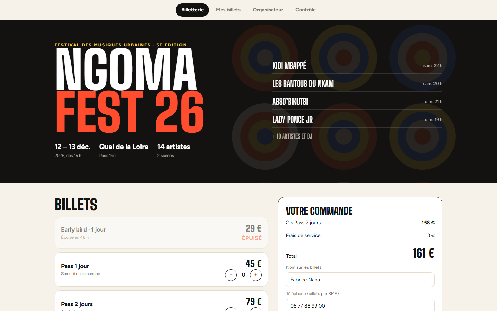
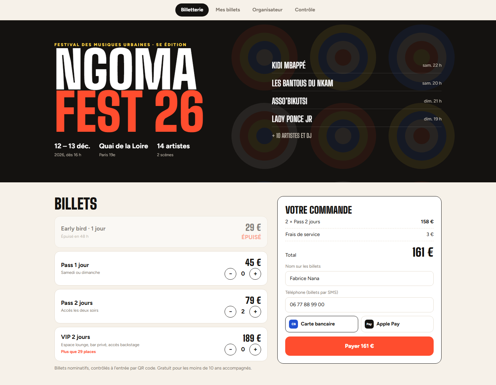
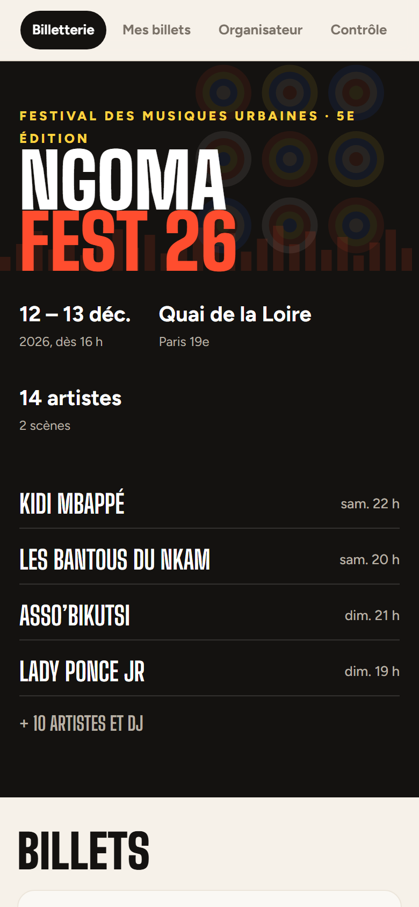

# Ngoma Fest

**Billetterie en ligne et contrôle d'accès par QR code** — Plateforme de billetterie pour un festival : page de l'événement avec programmation, choix des billets et jauges, paiement par carte bancaire ou Apple Pay, e-billets nominatifs avec QR code signé, tableau de bord de l'organisateur (ventes, recettes, remplissage, entrées) et application de contrôle à l'entrée qui scanne à la caméra et détecte les billets falsifiés, déjà utilisés ou hors date.

**Démo en ligne : [https://lordlennyx.github.io/ngoma-billetterie/](https://lordlennyx.github.io/ngoma-billetterie/)**

Spot de présentation (30 s) : [media/spot-30s.mp4](https://lordlennyx.github.io/ngoma-billetterie/media/spot-30s.mp4)

## Ce que le projet montre

- Page événement : affiche générative, programmation, catégories de billets, places restantes, catégorie épuisée
- Commande : quantités, frais de service, jour du pass, paiement par carte simulé (3-D Secure)
- E-billets nominatifs avec QR code (signature anti-fraude) et talon détachable
- Organisateur : billets vendus, recettes, remplissage, entrées, ventes sur 30 jours, jauges, flux des ventes
- Contrôle : scan caméra (jsQR) ou simulation, retours visuels et vibration : validé, déjà utilisé, mauvais jour, falsifié

## Réalisation

- **Stack :** HTML, CSS, JavaScript, qrcode-generator, jsQR, getUserMedia
- **Typographies :** Big Shoulders Display, Figtree
- **Évolutions possibles :** paiement réel (CinetPay, Notch Pay), envoi des billets par WhatsApp, mode hors ligne pour les contrôleurs, plan de salle avec places numérotées

| Bureau | Mobile |
|---|---|
|  |  |

---

Client et contenus fictifs, créés pour la démonstration. Conception, design et développement : **Njundiyimun Béchard** — [github.com/LordLennyx](https://github.com/LordLennyx)
